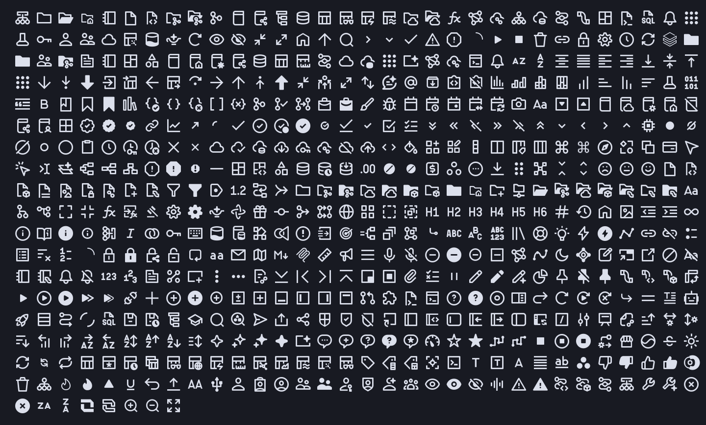

# databricks-nf

A NerdFont that provides glyphs of the Databricks icons for use in terminal user interfaces. Each glyph is based on the original icon, and not repackaging or redistributing those icons.

## Install

- **Linux:** copy `DatabricksSymbolsNF-Regular.ttf` to `~/.local/share/fonts/` and run `fc-cache -f`
- **macOS:** copy it to `~/Library/Fonts/`
- **Windows:** right-click it and choose Install for current user

Restart the terminal afterwards. The glyphs sit at `U+F3000`-`U+F32F0`; most terminals fall back to the font for these codepoints by themselves.

## Sources

Original icon shapes are the intellectual property and Copyright (C) Databricks, Inc.: [`@databricks/design-system`](https://www.npmjs.com/package/@databricks/design-system), ISC; Databricks web UI icons and logo.

Details and licence texts: [THIRD_PARTY_NOTICES.md](THIRD_PARTY_NOTICES.md).

## License

The font file is [MIT](LICENSE). The original icon artwork stays under its owners' terms, listed in [THIRD_PARTY_NOTICES.md](THIRD_PARTY_NOTICES.md). Databricks and the Databricks logo are trademarks of Databricks, Inc.; this font is not affiliated with or endorsed by Databricks, Inc.
